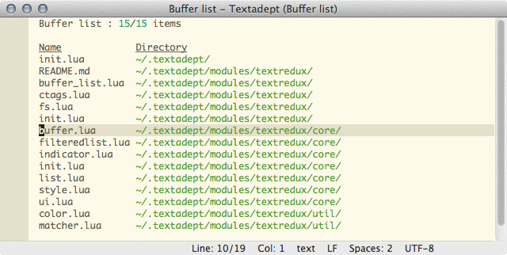

Textredux is a module for the [Textadept editor](http://foicica.com/textadept/)
that offers a set of text based replacement interfaces for core Textadept
functionality.



Textredux has been updated with API changes Textadept 13 beta 3.

The API docs are generated with [ldoc](https://stevedonovan.github.io/ldoc/):

```
cd docs
ldoc .
```

The Textredux module is released under the MIT license.
Please visit the [homepage](http://rgieseke.github.io/textredux/) for
more information.
